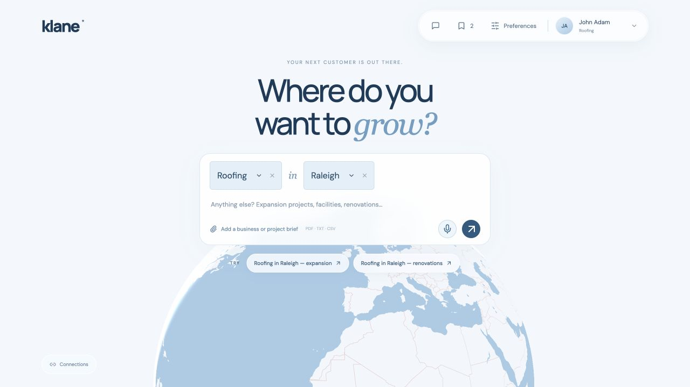
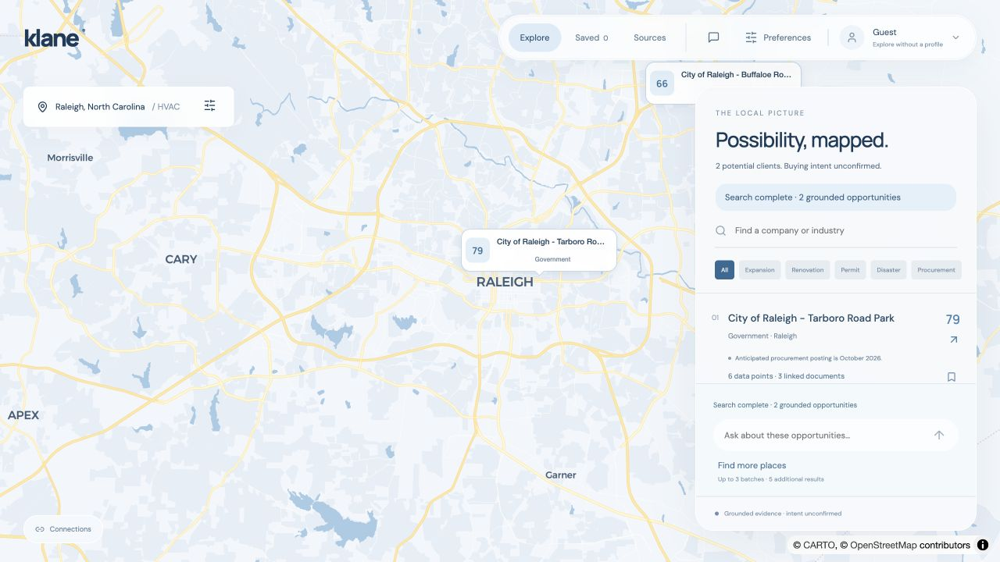
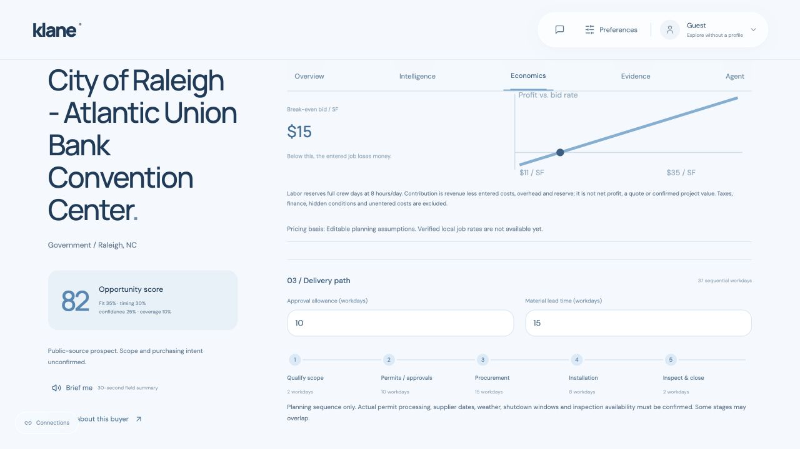
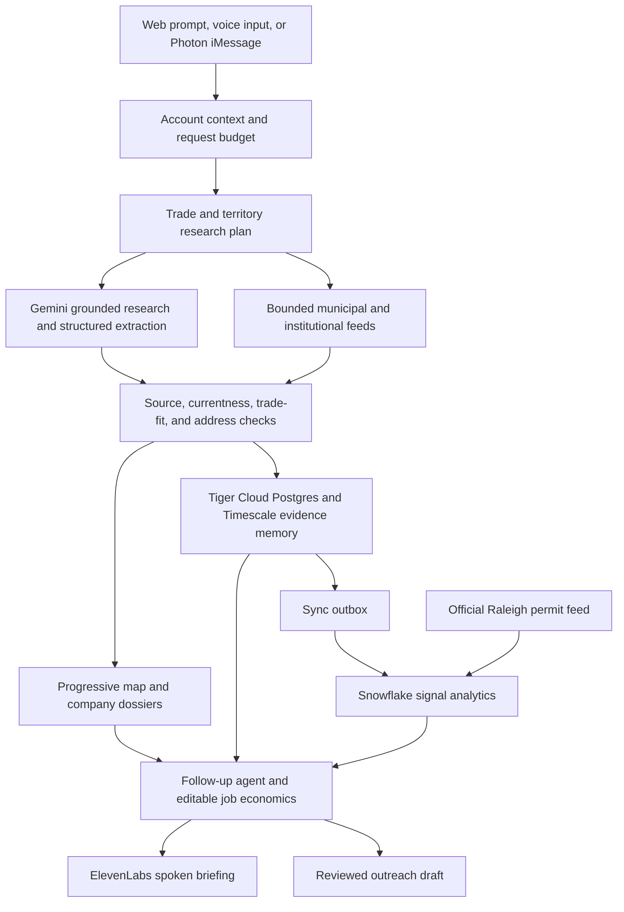

# Klane

**Your next customer is out there. Klane helps you find the evidence.**

Built for **HackNC 2026**, Klane turns public project signals into a contractor’s next practical conversation. Describe your trade and territory, explore potential buyers on a map, inspect their sources, and plan a proposed work package—or text the same research assistant from the field.

**[Klane Demo Video — YouTube](https://www.youtube.com/watch?v=Pd8Jszdwcus)** · **[Project Domain — klane.tech (Not Currently Used!)](https://klane.tech)**

## A look inside

### Describe your work



### Explore the local picture



### Plan the work package



Screenshots capture development sessions. Public-source opportunities change over time; displayed estimates are editable planning assumptions.

## Inspiration

A roofing contractor should not have to spend their evening searching permit portals, procurement notices, and expansion announcements to find tomorrow’s work. Useful signals often appear before someone posts a straightforward request for a contractor. We wanted to connect those scattered clues to the right trade, location, and next step, in an interface people could use between jobs.

The design combines Carolina blue with Frutiger Aero’s sense of space and movement: an interactive globe, frosted controls, and a transition into a local opportunity map.

## What it does

- Remembers a business profile, trade, and territory. Guest, John Adam, and Maya Chen demonstrate different starting contexts.
- Runs bounded research across public news, official project pages, permits, procurement notices, and institutional announcements, revealing initial results while additional batches continue.
- Filters candidates for trade relevance, currentness, source support, and physical location, including checks for competing contractors and expired procurement notices.
- Opens company dossiers with dated indicators, titled evidence links, proposed scope, timing, and published professional contact research when available.
- Models materials, labor, equipment, overhead, reserve, staffing, break-even bids, and installation timelines from editable job assumptions.
- Supports voice search, spoken briefings, follow-up chat, saved prospects, and an account-aware iMessage agent.
- Records evidence observations over time and shows permit reference analytics. Outreach requires review and approval of the recipient and message.

Public evidence indicates a prospect, not confirmed purchasing intention. A bounded search can return fewer results when evidence fails the checks. Contact details require published source support.

## How we built it

React, TypeScript, Vite, custom CSS, MapLibre GL, and Lucide power the interface. A Node.js HTTP server keeps provider credentials outside the browser, validates data with Zod, and coordinates research, voice, messaging, and database adapters.

## Technical Toolkit

<table>
  <tr>
    <td align="center" width="25%"><b>Languages</b></td>
    <td>
      
      
      
      
      
    </td>
  </tr>
  <tr>
    <td align="center" width="25%"><b>Interface & Development</b></td>
    <td>
      
      
      
      
      
      
      
    </td>
  </tr>
  <tr>
    <td align="center" width="25%"><b>AI & Messaging</b></td>
    <td>
      
      
      
      
    </td>
  </tr>
  <tr>
    <td align="center" width="25%"><b>Data & Platforms</b></td>
    <td>
      
      
      
      
      
      
    </td>
  </tr>
</table>

### Program and data flow



**Gemini:** grounded discovery, structured extraction, account-aware answers, uploaded brief interpretation, and proposed estimate assumptions. The adapters support a Gemini API key or Vertex AI ADC. The development demo currently uses Gemini through Vertex AI; an API-key text request was separately verified, while grounded API-key requests encountered quota limits.

**Photon:** Spectrum powers iMessage. Verified sender mappings connect conversations to contractor profiles. Explicit requests for another trade override the profile default; messaging can launch fresh research without a prior website scan.

**ElevenLabs:** Scribe provides microphone transcription with live partial text through the realtime integration. Flash provides spoken company briefings; alignment timestamps drive word progress when available.

**Tiger Data:** Tiger Cloud hosts operational Postgres/Timescale storage for profiles, discovered companies, signal observations, conversation context, outreach receipts, and the warehouse outbox. Weekly evidence history measures what Klane observed over time; it does not establish market-wide demand. Web favorites currently remain browser-local.

**Snowflake:** receives signal events from Tiger’s outbox and stores official permit reference data. The development warehouse was loaded with 2,000 real City of Raleigh permit records. Issue-week activity, coverage dates, and declared whole-project valuations provide context. A separate comparable-job table supports verified completed-job rates only when enough matching records exist. No verified paid-job dataset is included, and permit valuations are never substituted for contractor prices.

**.tech:** `klane.tech` is the acquired project domain. Hosting, production authentication, and domain routing remain next steps.

Other public services include official ArcGIS permit/address feeds, US Census address geocoding, and CARTO/OpenStreetMap basemap data. Google Search grounding discovers indexed sources; Klane is not an exhaustive crawler of every local record system.

### Keeping research bounded

A discovery run uses up to three batches targeting five qualified buyers, capped model outputs, and a configurable per-minute call budget. Caching, shared in-flight requests, bounded source fetches, and on-demand dossiers reduce repeated calls. Follow-up questions reuse account and company context. Provider quotas and insufficient evidence can still limit a run.

## Challenges we ran into

Finding a mention of “electrical” is easier than finding an actual buyer for electrical work. We iterated on competitor filtering, stale bid deadlines, explicit trade scope, source corroboration, and address verification. We also worked through provider quotas, ADC setup, Snowflake network access, and the distinction between permit valuations and completed-job prices.

Globe interaction and globe-to-map transitions required careful camera and animation handling. Live microphone text, readable iMessage replies, and evidence presentation each needed their own interaction patterns.

## Accomplishments that we're proud of

We connected web research and a field messaging agent to the same account-aware backend. We built a progressive map, linked evidence dossiers, inspectable work-package economics, and a real database-to-warehouse flow. We chose to withhold unsupported prices and stale prospects instead of filling the interface with invented data.

## What we learned

Useful research is a chain of checks: who the buyer is, what work is supported, where it happens, when the signal matters, and which source establishes each claim. We learned to use operational storage for memory, a warehouse for aggregated reference data, and deterministic calculations for estimates users can inspect.

## What's next for Klane

Expand official municipal coverage, add verified completed-contract comparables, improve contact-role coverage, and evaluate opportunity relevance with real contractors. Deploy behind production authentication with stable database egress, connect `klane.tech`, and add durable scheduled research and approved follow-up workflows.

## HackNC 2026 tracks

- General Track
- Best iMessage Agent with Photon
- Best Use of Gemini API
- Best Use of ElevenLabs
- Best Use of Snowflake API
- Best .Tech Domain Name
- Best Use of Tiger Data

These are the intended submission categories. Current implementation and limitations are described above.

## Run locally

Use Node.js 22 or later.

```bash
npm ci
cp .env.example .env
npm run dev
```

The default `VITE_API_MODE=demo` runs the interface with demo data. To use live integrations, set `VITE_API_MODE=live`, configure server-only values in `.env`, and start the backend in another terminal:

```bash
npm run server
```

For Vertex AI, set `GEMINI_AUTH_MODE=adc`, your Google Cloud project and location, and configure Application Default Credentials locally. For the API-key adapter, set `GEMINI_AUTH_MODE=api-key` and a `GEMINI_MODEL` supported by your project. Keep credentials and ADC files outside Git.

Database scripts:

```bash
npm run db:migrate
npm run warehouse:schema
npm run permits:import
npm run warehouse:sync
```

Supply Tiger/Snowflake settings before running these commands. `server/sql/snowflake-setup.sql` provisions initial Snowflake resources; the schema command creates warehouse tables. `npm run prices:import` requires genuine completed-contract records, not permit values.

After registering allowed users in Photon and configuring credentials and `PHOTON_USERS`, run:

```bash
npm run photon
```

Validation:

```bash
npm test
npm run build
npm run integrations:check
```

`npm run integrations:smoke` makes live provider requests and can consume quota. See [the two-minute demo flow](DEMO-FLOW.md) for recording notes.

## AI disclosure

**OpenAI ChatGPT 6.1 Sol was used for coding assistance**, including implementation, debugging, interface iteration, tests, and documentation. Project direction, priorities, integration choices, and review were guided by the project creator. Runtime AI features use the Gemini and ElevenLabs integrations described above.
